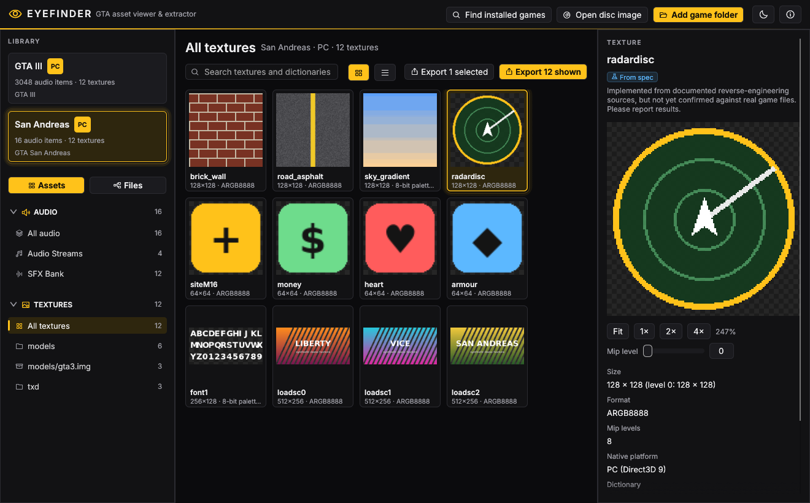
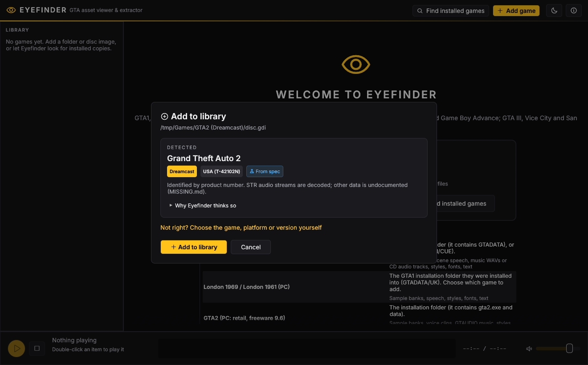
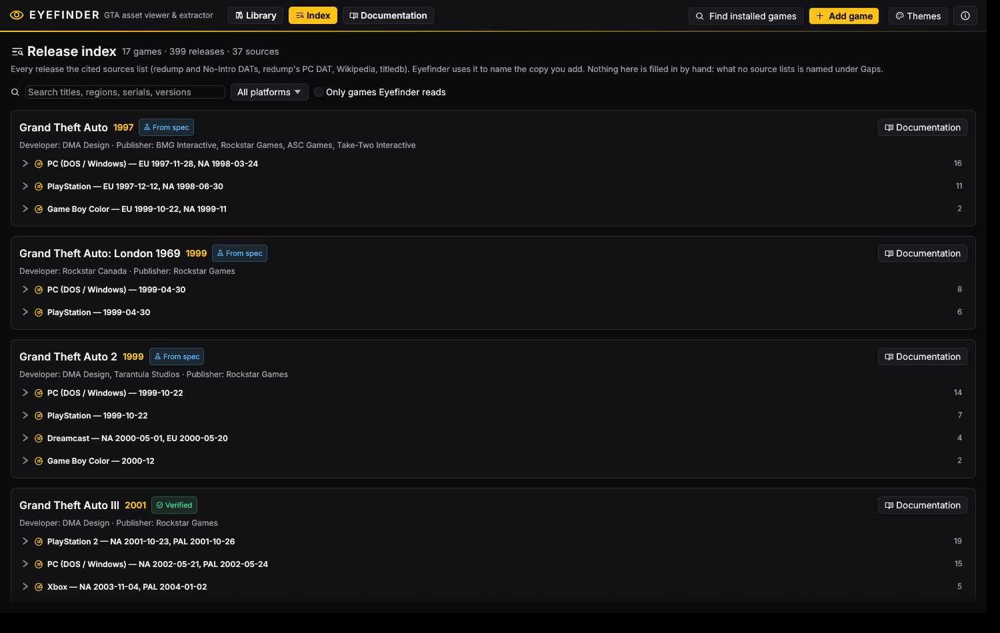
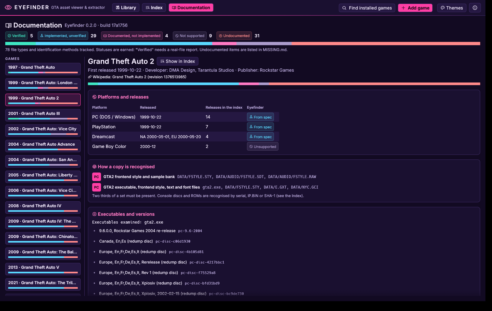
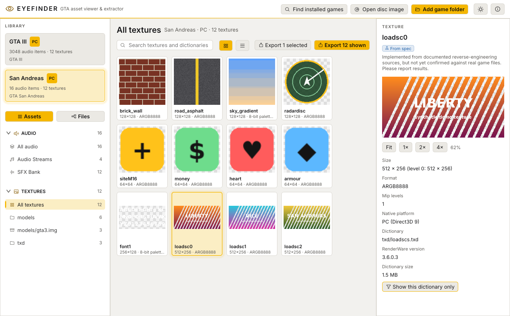

# Eyefinder

**A viewer and extractor for the assets of Grand Theft Auto: GTA1, London 1969, London 1961,
GTA2, GTA Advance, GTA III, Vice City and San Andreas.**

Eyefinder opens a game folder, a disc image or a cartridge ROM, works out which game, platform,
version and store it is, and lets you browse, preview and export its contents. It handles **audio**
(radio stations, cutscenes, mission lines, sound effects, music, CD audio tracks) and **textures**
(texture dictionaries, loose or inside IMG archives; GTA1/GTA2 styles, fonts and images), and shows
the **text** of the 2D games. Models and other data will follow.



## Features

* **Add games your way:** one **Add game** dialog with a drop zone, or the welcome screen.
  * Accepted: a PC install folder, an extracted disc, a disc image read directly (ISO, BIN/CUE, Dreamcast GDI, DiscJuggler CDI, PS2 POPStarter VCD), a Game Boy Color / Advance ROM, or any of a game's own files.
  * **Find installed games** looks through your Steam libraries, the Rockstar Games Launcher and the Rockstar Games folders.
  * Identification runs in the background, so the window never freezes.
* **Choose the game, platform and version:** Eyefinder detects them, shows its evidence, and lets you change them.
  * PC: the executable build and the store (Steam, Rockstar Games Launcher, retail); a retail disc image by its redump tracks.
  * Consoles and handhelds: the disc serial (PS1, PS2), the Dreamcast IP.BIN fields, or the cartridge ROM.
  * Only choices the files actually support are offered. A folder holding several games (GTA1 with the London packs) lets you add each of them.
* **A library grouped by game**, in release order, with every copy on two compact lines (platform, store, version, file, counts).
* **Index page:** every Grand Theft Auto game, platform, regional release, edition and version that the cited sources list (redump and No-Intro DATs, redump's PC DAT, Wikipedia, titledb), with how Eyefinder identifies each one, and the gaps no source covers yet.
* **Documentation page:** a tracker for this build. Per game, every file type with its status (verified, implemented but unverified, documented but not implemented, not supported, undocumented), sources, real-file confirmations and what is missing, plus how copies are recognised and which executables and versions are known.
* **Sidebar sections per asset type** (Audio by category, Textures by folder or archive), or switch to the **file tree**. IMG archives open like folders, and any file can be inspected and copied byte for byte.
* **Textures:**
  * A thumbnail grid or a list, and a large preview with zoom, mip levels and a transparency checkerboard.
  * Supported natives: Direct3D 8/9 (PC), Xbox and PS2, including palettes, DXT1/3/5 and swizzled PS2/Xbox data.
  * Export to PNG, optionally every mip level, with DXT data also kept untouched as `.dds`.
* **Audio:**
  * Play anything instantly, with a waveform, sample-exact seeking and volume control. Hour-long radio stations are streamed, never loaded whole.
  * Export to WAV with nothing lost on the way:
    * PCM is copied bit for bit.
    * ADPCM is decoded to its exact 16-bit output.
    * MP3/MP2/Vorbis are decoded at full 32-bit float precision.
    * Nothing is resampled.
* **Metadata with every export:** `manifest.json` and `manifest.csv` (plus `tracklist.txt` for audio). Audio exports also include:
  * cue markers (as per-marker track files, `.cue` sheets and Audacity labels),
  * SFX loop points,
  * San Andreas beat data,
  * the untouched movie audio bitstream.
* **Honest about what it knows:** every item shows a support level. Nothing is guessed.
* **Themes:** Dark, Light, Follow system, and Vice City Night (Themes menu, top-right).







## Supported games

| | PC | PS2 | Xbox / mobile / Mac |
|---|---|---|---|
| GTA III audio | ✅ Verified | 🧪 From spec (streams) | Recognised only |
| Vice City audio | 🧪 From spec | 🧪 From spec (streams) | Recognised only |
| San Andreas audio | 🧪 From spec (streams + SFX) | Recognised only | Recognised only |
| Textures (all three games) | 🧪 From spec | 🧪 From spec | 🧪 From spec (Xbox natives) |

| 2D games | PC | PlayStation | Dreamcast | Game Boy Color / Advance |
|---|---|---|---|---|
| GTA1, London 1969 / 1961 | 🧪 Audio, CD audio, styles, fonts, text | 🧪 CD audio; rest recognised only | — | GTA1 GBC: recognised only |
| GTA2 | 🧪 Audio, music, styles, frontend images, text | Recognised only | 🧪 STR audio; rest recognised only | GTA2 GBC: recognised only |
| GTA Advance | — | — | — | Recognised only |

What has no public documentation is listed in [MISSING.md](MISSING.md).

**Verified** means checked against real game files. **From spec** means implemented from
documented sources (reverse-engineered game code, librw, official specifications) and tested
against synthetic files and independent reference decoders, but not yet confirmed on a real copy.
The full matrix, with sources, is in [docs/SUPPORT.md](docs/SUPPORT.md) and the byte layouts are
in [docs/FORMATS.md](docs/FORMATS.md).

**Have one of these games?** A [format report](CONTRIBUTING.md#reporting-a-format-result) is the
fastest way to move a format to Verified. The Definitive Edition is not supported: it uses entirely
different formats.



## Download

Builds for Windows, macOS and Linux are attached to each
[release](https://github.com/galaxygas/Eyefinder/releases). Unzip and run `eyefinder` (or
`eyefinder.exe`). The macOS build is not signed: right-click the app and choose *Open* the first
time.

The command-line tool runs without the GUI:

```sh
eyefinder-cli scan                                                  # find installed copies
eyefinder-cli info     "C:\Games\GTA Vice City"
eyefinder-cli versions "C:\Games\GTA San Andreas"                   # the choices it accepts
eyefinder-cli export   "C:\Games\GTA Vice City" "D:\VC audio"       # all audio
eyefinder-cli textures "C:\Games\GTA San Andreas" "D:\SA textures" --mipmaps
eyefinder-cli export   gta3_ps2.iso out --only "Radio Stations" --pcm16
eyefinder-cli info     sa.iso --game sa --platform ps2 --version ps2-SLUS-20946
eyefinder-cli info     "C:\Games\GTA" --game london1969                # GTA1 folder with London installed
eyefinder-cli export   "GTA (USA).cue" out                              # PS1: the CD audio tracks
eyefinder-cli text     "C:\Games\GTA2"                                 # GTA2 GXT / GTA1 FXT text
```

## Building from source

Rust 1.95 or newer. On Linux, first install
`libasound2-dev libgtk-3-dev libxkbcommon-dev libwayland-dev libgl1-mesa-dev pkg-config`.

```sh
cargo run --release -p eyefinder            # the app
cargo run --release -p eyefinder-cli -- ... # the command line tool
cargo test --workspace                      # all tests
```

## How correctness is checked

Every change runs on Windows, macOS and Linux against synthetic fixtures. There is no game data in
this repository. Outputs are compared with independent references:
* **GTA III PC audio:** the original GTA III ripper, which was verified on real files (`tools/legacy-c`).
* **PS2 audio, Dreamcast STR:** vgmstream.
* **CD audio tracks:** ffmpeg.
* **Vice City and San Andreas audio:** the de-obfuscated source streams.
* **Textures** (`tools/txd-ref`):
  * **librw**, for the stored texture data and PS2 unswizzling;
  * an exact **specification decoder**, for every pixel;
  * **Pillow**, as a cross-check.
* **Seeking:** checked to be sample-exact for every decoder.

See [docs/SUPPORT.md](docs/SUPPORT.md#how-the-implementations-were-checked).

## Contributing

Contributions from people and AI agents are welcome through pull requests. Read
[CONTRIBUTING.md](CONTRIBUTING.md) and [AGENTS.md](AGENTS.md) first. The main rule: cite a source
for every format detail, or leave it unsupported.

## Legal

Eyefinder is licensed under the **GNU General Public License v3.0 or later** ([LICENSE](LICENSE)).
It contains no game data and only works with copies you own. It is not affiliated with or endorsed
by Rockstar Games or Take-Two Interactive. Grand Theft Auto is a trademark of Take-Two Interactive.

Third-party components:
* [Symphonia](https://github.com/pdeljanov/Symphonia) (MPL-2.0)
* [egui/eframe](https://github.com/emilk/egui) (MIT / Apache-2.0)
* [rodio](https://github.com/RustAudio/rodio) (MIT / Apache-2.0)
* [png](https://github.com/image-rs/image-png) (MIT / Apache-2.0)
* [winreg](https://github.com/gentoo90/winreg-rs) (MIT, Windows only)
* [Inter](https://github.com/rsms/inter) (OFL-1.1, see `apps/eyefinder/assets/fonts`)
* [Phosphor Icons](https://github.com/phosphor-icons) (MIT)
* [minimp3](https://github.com/lieff/minimp3) (CC0, in the legacy C tool)
* [librw](https://github.com/aap/librw) (MIT; used only by the test reference tool, fetched at build time)

Format knowledge comes from the re3/reVC, gta-reversed, librw and vgmstream projects, the gtamods
wiki, plugin-sdk, PCSX2's game database and the official Khronos, Vulkan and Microsoft
specifications.

### Earlier PC games (development branch)

Import the installation root containing `GTADATA` for GTA1/London, or `DATA` for
GTA2. The app reads documented SDT/RAW sound banks, loose WAVs, and GRY/G24/STY
style graphics. London-only imports offer explicit 1969/1961 choices because the
bank layout is shared. CLI choices include `gta1`, `london1969`, `london1961`, `gta2`.
See [the support matrix](docs/SUPPORT.md) for the precise asset limits. These
implementations are tested against synthetic references and are not yet verified
on real game files. Earlier console/handheld releases are not covered by these PC readers.

### Importing earlier PC games

Use **Add game folder** for GTA1, London or GTA2 installations. You can select the
installation root, `GTADATA`/`DATA`, or its `AUDIO` folder. **Open files** supports
multiple selections, including GRY/G24/STY/FON textures, SDT/RAW banks and
ISO/BIN/CUE data images. Drag-and-drop and opening files with the executable use
the same importer. Selecting an asset imports its containing game/data directory
so companion files remain available; selections from one installation are grouped.
Loose GTA1/London textures prompt for the game because the format is shared.

Compressed downloads/installers must be extracted first. BIN/CUE data-container
support does not add PlayStation, GBC, GBA or Dreamcast asset decoders. A recognized
PC format is still **Implemented from spec** until confirmed with real files.
The window title, welcome screen and About dialog show the build commit so reports
can identify exactly which executable was tested.
