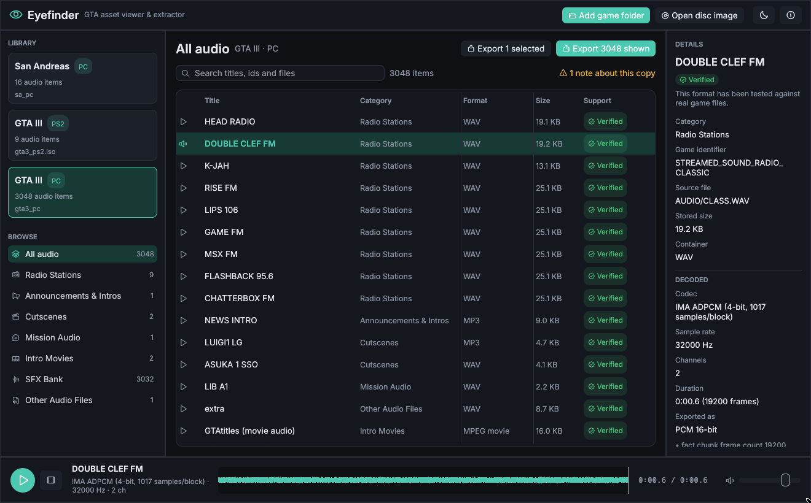
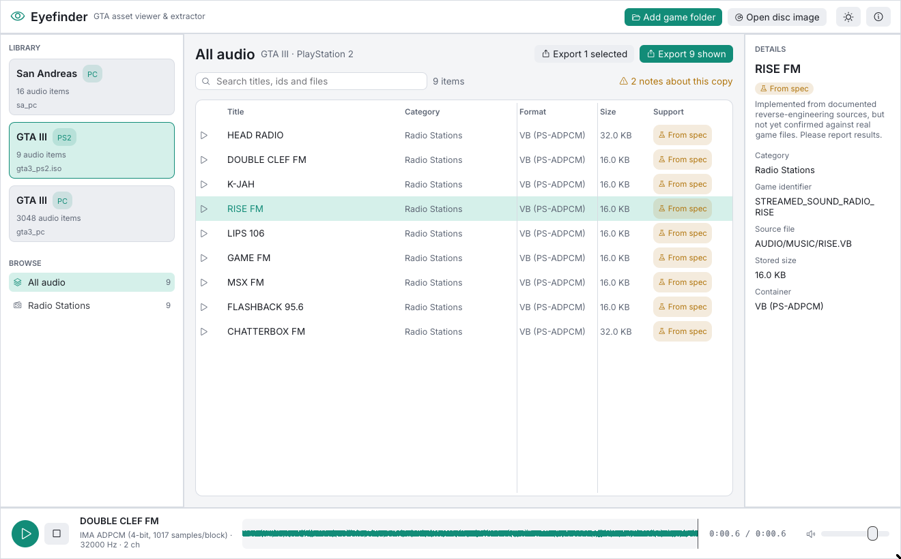

# Eyefinder

**A viewer and extractor for the assets of Grand Theft Auto III, Vice City and San Andreas.**

Eyefinder opens a game folder or a disc image, works out which game and platform it is, and lets
you browse, play and export its contents. It currently handles **audio**: every radio station,
cutscene, mission line, sound effect and the music of the intro movies. Textures, models and other
data will follow.



## Features

* **Drop in a game:** a PC install folder, an extracted disc, or a PS2 `.iso` read directly. Eyefinder detects the game and platform and says which evidence it used.
* **Browse and search** thousands of items, grouped by category: radio stations, San Andreas stream packs, police radio and ambience, announcements, cutscenes, music cues, mission audio, intro movies, SFX banks.
* **Play anything instantly**, with a waveform, sample-exact seeking and volume control. Hour-long radio stations are streamed, never loaded whole.
* **Export to WAV** with nothing lost on the way:
  * PCM is copied bit for bit.
  * ADPCM is decoded to its exact 16-bit output.
  * MP3/MP2/Vorbis are decoded at full 32-bit float precision.
  * Nothing is resampled.
* **Metadata with every export:** `manifest.json`, `manifest.csv` and `tracklist.txt` with exact durations and source codecs. Also included:
  * cue markers (written as per-marker track files, `.cue` sheets and Audacity labels),
  * SFX loop points,
  * San Andreas beat data,
  * the untouched movie audio bitstream.
* **Honest about what it knows:** every item shows a support level. Nothing is guessed.



## Supported games

| | PC | PS2 | Xbox / mobile / Mac |
|---|---|---|---|
| GTA III | ✅ Verified | 🧪 From spec (streams) | Recognised only |
| Vice City | 🧪 From spec | 🧪 From spec (streams) | Recognised only |
| San Andreas | 🧪 From spec (streams + SFX) | Recognised only | Recognised only |

**Verified** means checked against real game files. **From spec** means implemented from
documented reverse-engineering sources and tested against synthetic files, but not yet confirmed
on a real copy. The full matrix, with sources, is in [docs/SUPPORT.md](docs/SUPPORT.md) and the
byte layouts are in [docs/FORMATS.md](docs/FORMATS.md).

**Have one of these games?** A [format report](CONTRIBUTING.md#reporting-a-format-result) is the
fastest way to move a format to Verified. The Definitive Edition is not supported: it uses entirely different formats.

## Download

Builds for Windows, macOS and Linux are attached to each
[release](../../releases). Unzip and run `eyefinder` (or `eyefinder.exe`). The macOS build is not
signed: right-click the app and choose *Open* the first time.

The command-line tool runs without the GUI:

```sh
eyefinder-cli info   "C:\Games\GTA Vice City"
eyefinder-cli export "C:\Games\GTA Vice City" "D:\VC audio"        # everything
eyefinder-cli export gta3_ps2.iso out --only "Radio Stations" --pcm16
```

## Building from source

Rust 1.95 or newer. On Linux, first install
`libasound2-dev libgtk-3-dev libxkbcommon-dev libwayland-dev libgl1-mesa-dev pkg-config`.

```sh
cargo run --release -p eyefinder            # the app
cargo run --release -p eyefinder-cli -- ... # the command line tool
cargo test --workspace                      # all tests
```

## How correctness is checked

Every change runs on Windows, macOS and Linux against synthetic fixtures (no game data in this
repository). Outputs are compared with independent references:
* the original GTA III ripper verified on real files (`tools/legacy-c`),
* vgmstream for PS2 audio,
* the de-obfuscated source streams for Vice City and San Andreas.

Seeking is checked to be sample-exact for every decoder. See [docs/SUPPORT.md](docs/SUPPORT.md#how-the-implementations-were-checked).

## Contributing

Contributions from people and AI agents are welcome through pull requests. Read
[CONTRIBUTING.md](CONTRIBUTING.md) and [AGENTS.md](AGENTS.md) first. The main rule: cite a source
for every format detail, or leave it unsupported.

## Legal

Eyefinder is licensed under the **GNU General Public License v3.0 or later** ([LICENSE](LICENSE)).
It contains no game data and only works with copies you own. It is not affiliated with or endorsed
by Rockstar Games or Take-Two Interactive. Grand Theft Auto is a trademark of Take-Two Interactive.

Third-party components:
* [Symphonia](https://github.com/pdeljanov/Symphonia) (MPL-2.0)
* [egui/eframe](https://github.com/emilk/egui) (MIT / Apache-2.0)
* [rodio](https://github.com/RustAudio/rodio) (MIT / Apache-2.0)
* [Inter](https://github.com/rsms/inter) (OFL-1.1, see `apps/eyefinder/assets/fonts`)
* [Phosphor Icons](https://github.com/phosphor-icons) (MIT)
* [minimp3](https://github.com/lieff/minimp3) (CC0, in the legacy C tool)

Format knowledge comes from the re3/reVC and gta-reversed reverse-engineering projects and from
vgmstream.
